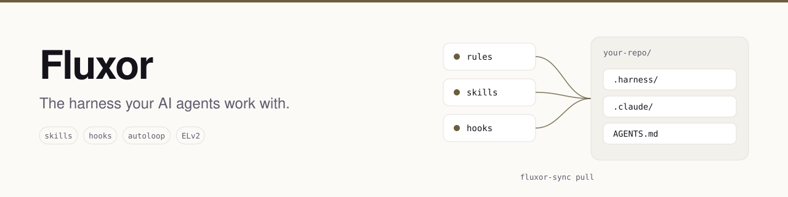
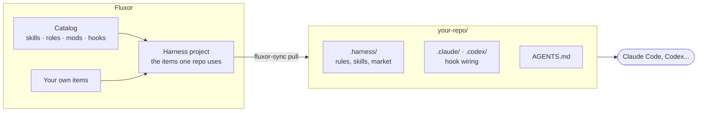
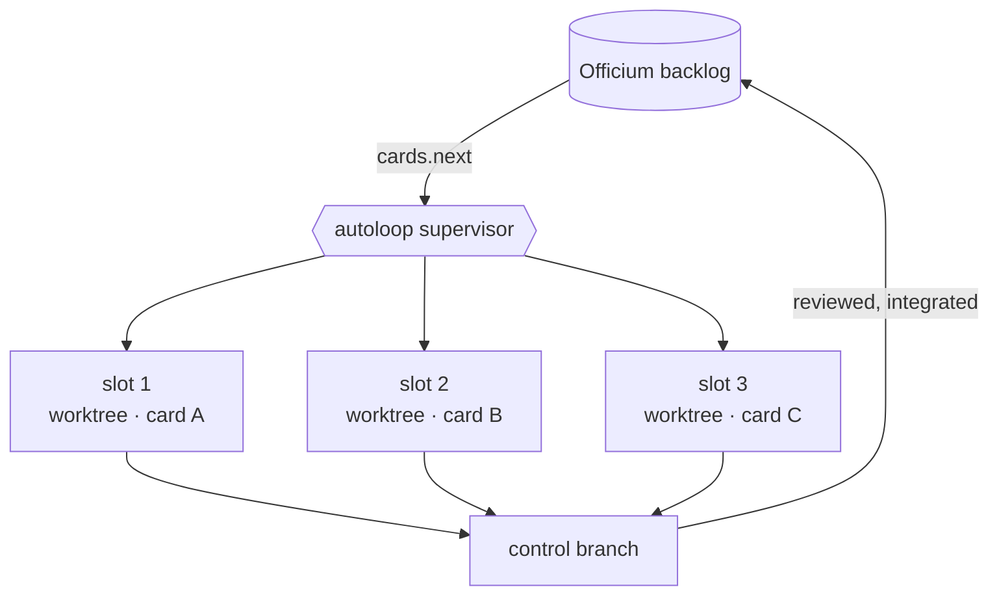

<p align="center">
  <picture>
    <source media="(prefers-color-scheme: dark)" srcset=".github/assets/banner-dark.svg">
    
  </picture>
</p>

<p align="center">
  <a href="LICENSE"></a>
  
  
  
</p>

<p align="center">
  <a href="#quick-start"><b>Quick start</b></a> ·
  <a href="#how-it-works">How it works</a> ·
  <a href="#autoloop-several-agents-one-backlog">autoloop</a> ·
  <a href="#the-catalog">The catalog</a> ·
  <a href="https://javadaba.com/catalogue/fluxor"><b>Fluxor Cloud</b></a>
</p>

An agent is only as good as the harness around it: what it knows about your project, the skills it
can load, and the checks that stop it before it breaks something. Most teams keep that harness as a
pile of prompt files copied between repositories, and each copy drifts on its own.

**Fluxor keeps the harness as versioned items** (rules, skills, hooks and files), assembles the
right set for each project, and installs it into any repository with one command. Change an item
once, and every repository that uses it gets the change on its next `pull`.

This repository is **Fluxor Local**: free and self-hosted, running on your machine with Docker.
**[Fluxor Cloud](https://javadaba.com/catalogue/fluxor)** keeps every machine and every teammate on
the same harness.

## Quick start

You need Docker and Python 3.

```sh
git clone https://github.com/CMolG/fluxor.git && cd fluxor
docker compose up -d --build
claude mcp add --transport http fluxor http://127.0.0.1:18191/api/fluxor/mcp
```

Ask your agent to *"create a Fluxor harness project with the atoms and review-harness skills"*, or to
run `harness.bootstrap`, which answers with the exact commands for your repository. By hand:

```sh
cd /path/to/your/repo && mkdir -p .harness/bin
curl -fsS http://127.0.0.1:18191/api/fluxor/v1/writer/fluxor-sync.py -o .harness/bin/fluxor-sync.py
python3 .harness/bin/fluxor-sync.py init --server http://127.0.0.1:18191/api --enroll local --project <project-id>
```

This is what that looks like (real output; machine name and paths shortened):

```console
$ python3 .harness/bin/fluxor-sync.py init --server http://127.0.0.1:18191/api --enroll local --project 187ee517-... --storage local
fluxor-sync: enrolled as fluxor-sync on my-laptop on http://127.0.0.1:18191/api; the token is in ~/.config/fluxor/device-tokens.json
fluxor-sync: revision 1: 19 file(s) written, 0 removed, 12 downloaded

$ python3 .harness/bin/fluxor-sync.py status
project: 187ee517-...
server: http://127.0.0.1:18191/api
installed: revision 1, 18 file(s)
remote: up to date
```

From then on `fluxor-sync pull` brings the repository up to date, and `fluxor-sync item publish`
turns a folder of yours into an item you can select into any project.

> Hooks run code on your machine, so `fluxor-sync` never wires one without your consent
> (`fluxor-sync approve`). Everything listens on `127.0.0.1`; set `FLUXOR_LOCAL_TOKEN` to require a
> token, which then also becomes the enrollment code.

## How it works



- **Items, not copies.** Every skill, hook and file is one item with a content hash. A project is a
  selection of items, and a pull is a snapshot of that selection: what changed is written, what was
  dropped is removed, and your local edits are kept, never overwritten.
- **Atoms for each task.** A deterministic engine (`market/motor.py`) mounts a role, its mods and
  its steps for the prompt at hand, so the agent gets the instructions this task calls for instead
  of all of them at once.
- **One harness, every client.** The same items wire into Claude Code and Codex, and the harness
  can live outside git when you want (`--storage local`).

## autoloop: several agents, one backlog

`autoloop` is a skill in the catalog. It runs N agent sessions in parallel, each on a different card
in its own git worktree, all integrating into one control branch, while a supervisor clears each
session's context between cards.



It works the backlog of **[Officium](https://github.com/CMolG/officium)**, the board you and your
agents share.

## The catalog

The base catalog ships inside this repository (`packages/fluxor-market`) and is loaded into Fluxor
Local on start: **49 roles, 58 mods, 11 steps and 13 flows** for the atoms engine, **13 hooks**,
and these **15 skills**:

| Skill | What it does |
| --- | --- |
| `atoms` | Shows, explains or changes the role, mods and steps mounted for a task. |
| `autoloop` | Runs N agent sessions in parallel on the backlog, one worktree each. |
| `backlog` | A session protocol for working a tracker over MCP without agents stepping on each other. |
| `review-harness` | Checks that a harness is still wired and free of stale or broken references. |
| `topology` | Derives a workspace's real package graph and checks its layering rules. |
| `reduction` | A measure-first code-reduction campaign with 21 techniques for Java and React. |
| `layout-discipline` | Builds and reviews UI so nothing collapses, overlaps or overflows at any width. |
| `ui-fluidity-verification` | Frame, interaction and layout checks in real engines, with a statistical gate. |
| `ux-psychology` | Designs and audits interfaces with cognitive psychology, and flags dark patterns. |
| `landing-page-marketing` | Writes and audits landing pages that sell, checking every claim against facts. |
| `traffic-to-funnel` | Turns analytics data into a diagnosis and one funnel per product. |
| `product-hunt-launch-readiness` | Audits a product against Product Hunt's launch guide and builds the launch kit. |
| `research-radar` | Finds potentially novel techniques in a codebase and checks them against the state of the art. |
| `portfolio-positioning` | Turns a website into a hiring surface for its owner, page by page. |
| `jira-agentic-requirements-pipeline` | A two-phase requirements pipeline connected to Jira. |

## Local or Cloud

| | Local | Cloud |
| --- | :---: | :---: |
| Harness projects, items, `fluxor-sync` pull and publish | ✓ | ✓ |
| The base catalog and the atoms engine | ✓ | ✓ |
| MCP server for agents | ✓ | ✓ |
| autoloop and the Officium integration | ✓ | ✓ |
| Runs on your machine, nothing leaves it | ✓ | |
| One harness shared by a team, across every machine | | ✓ |
| The community marketplace, beyond the base catalog | | ✓ |
| Personal packs from the CEET interview (your working judgment as agents and skills) | | ✓ |
| The Fluxor web app: flow designer and harness library | | ✓ |
| Nothing to host or back up | | ✓ |

<p align="center"><a href="https://javadaba.com/catalogue/fluxor"><b>Try Fluxor Cloud →</b></a></p>

## Questions

**Is it free?** Yes. Fluxor Local is free to use, modify and self-host for your own work and your
company's, under the Elastic License 2.0. The one thing it does not allow is offering Fluxor to
others as a hosted service.

**Will it overwrite files I edited?** No. A pull keeps your local edits and tells you which ones it
kept; `pull --force` is the only way to take Fluxor's version over yours.

**Does it run hooks without asking?** No. A hook is wired only after you approve it, and a changed
hook asks again.

## Background

Fluxor carries the harness of FIERCE, a framework for software development where agents carry the
implementation and a few experts hold the decisions:

> Molina Galindo, C. (2026). *FIERCE: Fast Implementation Ensuring Results by Capable Experts.*
> [doi:10.5281/zenodo.23972303](https://doi.org/10.5281/zenodo.23972303)

## Repository layout

- `server/`: the API (Java, Quarkus): sync under `/api/fluxor/v1`, MCP under `/api/fluxor/mcp`.
  `fluxor-sync.py` ships inside it and is served at `/api/fluxor/v1/writer/fluxor-sync.py`.
- `packages/fluxor-market/`: the base catalog, its schemas and `tools/marketplace.py`.
- `scripts/seed-catalog.mjs`: regenerates the server's catalog seed from the catalog.
- `scripts/smoke.sh`: an end-to-end check, from `docker compose up` to a pulled harness.

This repository is published from the private monorepo where Fluxor is developed. Issues are
welcome; pull requests are ported by hand.

## License

[Elastic License 2.0](LICENSE). See [NOTICE](NOTICE).
